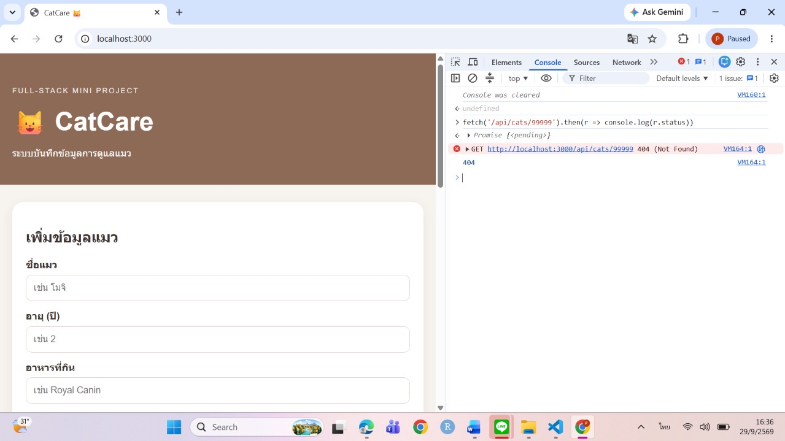
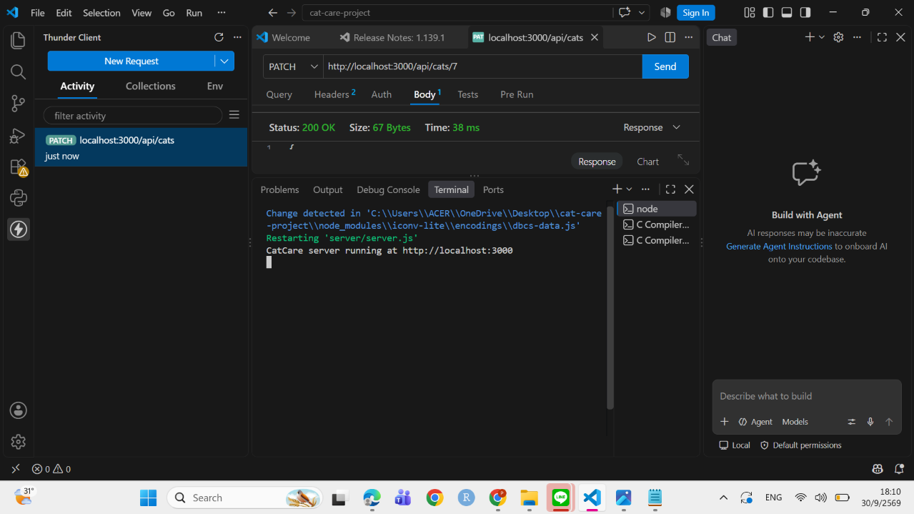
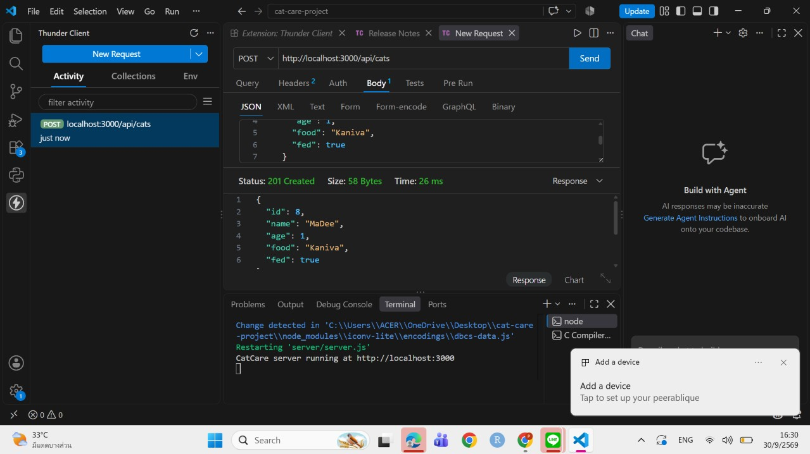

# 🐱 CatCare

Mini Project: Full-stack Web Application with REST API

## 1. รายละเอียดโปรเจกต์

CatCare เป็นเว็บแอปพลิเคชันสำหรับบันทึกข้อมูลการดูแลแมว พัฒนาด้วย Node.js และ Express.js สำหรับฝั่ง Server และ HTML, CSS, JavaScript สำหรับฝั่ง Client

ข้อมูลที่จัดเก็บ ได้แก่
- ชื่อแมว
- อายุ
- อาหาร
- สถานะการให้อาหาร

## 2. เทคโนโลยี

- Node.js
- Express.js
- HTML
- CSS
- JavaScript
- REST API
- Fetch API
- JSON file

## 3. โครงสร้างโปรเจกต์

```text
cat-care/
├── server/
│   ├── server.js
│   └── data/
│       └── cats.json
├── public/
│   ├── index.html
│   ├── style.css
│   └── script.js
├── screenshots/
├── report/
├── package.json
├── .gitignore
└── README.md
```

## 4. วิธีติดตั้ง

เปิด Terminal ในโฟลเดอร์โปรเจกต์ แล้วใช้คำสั่ง

```bash
npm install
```

## 5. วิธีรัน

```bash
npm run dev
```

จากนั้นเปิด

```text
http://localhost:3000
```

## 6. REST API Endpoints

| Method | Endpoint | รายละเอียด |
|---|---|---|
| GET | `/api/cats` | ดึงข้อมูลแมวทั้งหมด |
| GET | `/api/cats?fed=true` | กรองแมวที่ให้อาหารแล้ว |
| GET | `/api/cats?fed=false` | กรองแมวที่ยังไม่ได้ให้อาหาร |
| GET | `/api/cats/:id` | ดึงข้อมูลแมวตาม ID |
| POST | `/api/cats` | เพิ่มข้อมูลแมว |
| PATCH | `/api/cats/:id` | แก้ไขข้อมูลแมว |
| DELETE | `/api/cats/:id` | ลบข้อมูลแมว |

### ตัวอย่าง POST

```json
{
  "name": "ลัคกี้",
  "age": 3,
  "food": "Whiskas",
  "fed": false
}
```

### Status Codes

- `200` สำเร็จ
- `201` เพิ่มข้อมูลสำเร็จ
- `204` ลบข้อมูลสำเร็จ
- `400` ข้อมูลไม่ถูกต้องหรือไม่ครบ
- `404` ไม่พบข้อมูล

## 7. หลักฐานการดีบัก

ทดสอบ API ผ่าน Console ของเบราว์เซอร์ (DevTools) ด้วย `fetch()`

### ภาพที่ 1: GET `/api/cats/99999` → 404 Not Found

ดึงข้อมูลแมวด้วย id ที่ไม่มีอยู่ในระบบ เซิร์ฟเวอร์ตอบกลับสถานะ 404



### ภาพที่ 2: POST `/api/cats` → 400 Bad Request

ส่งข้อมูลไม่ครบ (`name` ว่าง ไม่มี `age`, `food`, `fed`) เซิร์ฟเวอร์ตอบกลับสถานะ 400


### ผลการทดสอบ status code ทั้งหมด

| การทดสอบ | ผลที่ได้ |
|---|---|
| GET id ที่ไม่มี | 404 |
| POST ข้อมูลไม่ครบ | 400 |
| POST ข้อมูลครบ | 201 |
| PATCH id ที่ไม่มี | 404 |
| DELETE | 204 |

## 8. Frontend

Frontend ใช้ `fetch()` เรียก REST API ของโปรเจกต์ตัวเอง โดยสามารถ:
- แสดงรายการข้อมูล
- เพิ่มข้อมูล
- แก้ไขข้อมูล
- ลบข้อมูล
- กรองข้อมูล
- อัปเดตหน้าเว็บโดยไม่ต้อง Reload

## 9. หลักฐานการดีบัก
- ภาพที่ 3: PATCH /api/cats/7 → 200 OK
แก้ไขข้อมูลแมวที่มี id 7 สำเร็จ เซิร์ฟเวอร์ตอบกลับสถานะ 200

- ภาพที่ 4: POST /api/cats → 201 Created
ส่งข้อมูลครบ (`name`, `age`, `food`, `fed`) เซิร์ฟเวอร์สร้างข้อมูลใหม่และตอบกลับสถานะ 201

